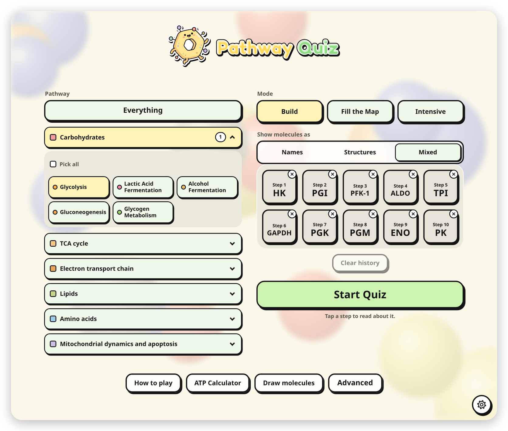
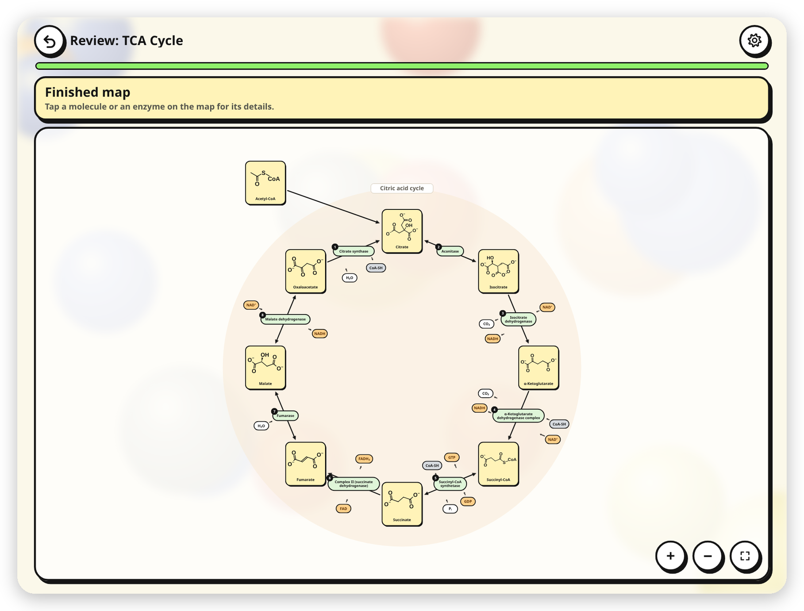
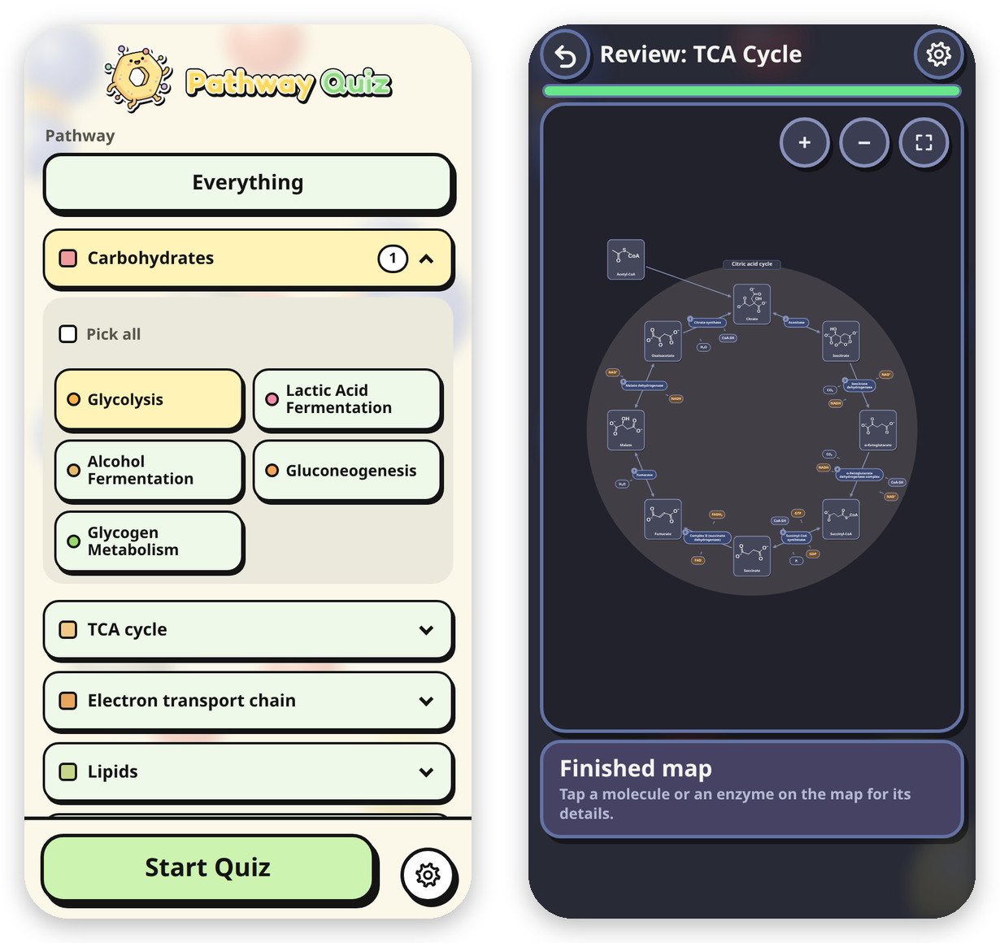

Learn metabolic pathways by building them. Each pathway is a flow chart of reactions. Fill in the molecules, enzymes and cofactors of every step and watch the map grow.

## Play

**[Play it in your browser](https://benbiochem.github.io/Biochemical-Pathways-Game/pathway_quiz.html).** No download, no sign-up, and it works on a phone.

To play offline, download `pathway_quiz.html` (open it above and press the download icon), then double-click it on a computer. It is one file: no install, no internet, nothing to set up.

1. **Pick a pathway.** Twenty-two of them, from glycolysis to the urea cycle, or Everything for all of it at once.
2. **Pick a way to play.** *Build* asks one question at a time and grows the map. *Fill the Map* is a blank map with six choices per blank. *Fill in the Blank* is a blank map where you type every answer. The Cofactors switch leaves out ATP, water and the other cofactors when you only want the molecules and enzymes.
3. **Start.** Hint gives a clue. Reveal shows the answer and counts as a miss. After a miss the game tells you why, and once you keep missing the same steps, Practice weak steps quizzes you on just those.

Also on the menu: an ATP Calculator, Draw molecules, where you finish or draw the structures, and Quizzes, where you compare two look-alike enzymes or molecules side by side and step through a mechanism one move at a time. Settings has a light and a dark theme (or Auto, which follows your device). The Advanced button at the bottom of the menu turns on photosynthesis, cell signaling and nucleotides with quizzes of their own, and Everything then holds every pathway.

## About the file

The whole game is that one HTML file: plain JavaScript and CSS, no libraries, no network. A pathway is data (a list of steps, each with its molecules, enzyme and cofactors, drawn on a chart), so the file can be read in any text editor.

## Contact

Want a pathway added, interested in collaborating in any way, or just want to talk? Email me at [benjaminellispeterson@gmail.com](mailto:benjaminellispeterson@gmail.com).

## License

Copyright (c) 2026 Benjamin E. Peterson. All rights reserved. Free to use for your own study and for teaching; any other use needs written permission. See [LICENSE](LICENSE).
